# 🏎️ BAU Campus Race

A 3D car racing and campus-tour game set on the campus of **Bangladesh Agricultural University (BAU), Mymensingh**, developed using **Python**, **PyOpenGL** and **pygame-ce**.

The real-map routes are built from **OpenStreetMap** data (real roads, building footprints, ponds and the railway), and the **CSM Department** and **AET Faculty** buildings are modelled from real photographs.

---

## 📌 Features

### 🏁 Race Mode
- Lap race against 5 AI cars (1 to 5 laps)
- Easy / Medium / Hard difficulty
- 4 cars to choose from, in 8 colours, shown in a showroom
- Nitro, handbrake drift and automatic gearbox
- Live position list, mini-map, speedometer and lap timer
- Best lap times saved for every route

### 🗺️ Campus Tour Mode
- Solo time trial through landmark checkpoints
- Information card for each landmark, with its name in Bangla and English
- Landmark camera that shows CSM, AET and Jobbar Moor for a few seconds
- Best tour times and visited landmarks saved

### 🌏 Campus World
- Real map of BAU from OpenStreetMap: roads, buildings, ponds, railway
- CSM and AET buildings with name boards, murals and the BiE lawn
- Jobbar Moor market with tea stalls, umbrellas, CNG autos and rickshaws
- Railway with a passing train, level crossings and station platform
- BINA, BAU Stadium, mosque, fish ponds, coconut grove and mango orchards
- Tree-lined roads with white-painted trunks and red-yellow boundary walls

### 🎮 Realism
- Morning / Noon / Evening / Night with lit windows and street lamps
- Clear / Hazy / Rain weather
- Car physics with grip, drift, gears and solid barrier collision
- Pedestrians at zebra crossings who wait, run and fall if hit (+3 s penalty)
- AI cars that brake for pedestrians
- Engine sound that follows RPM, horn, Bangla-style menu music and race music

---

## 🛠 Technologies Used

- Python 3
- PyOpenGL (OpenGL fixed-function pipeline)
- pygame-ce (window, input, sound)
- NumPy
- OpenStreetMap data

---

## 📸 Screenshots

<p align="center">
  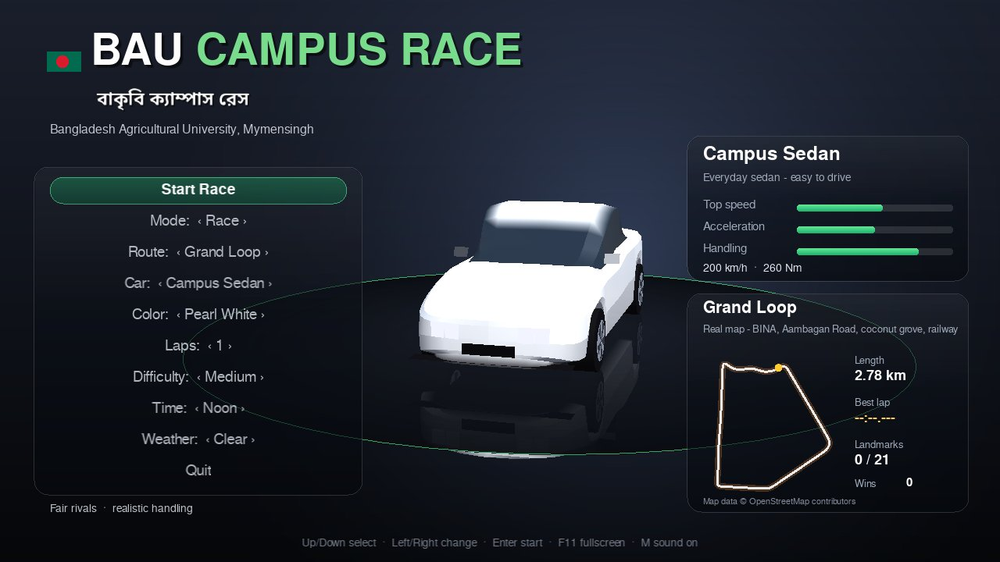
  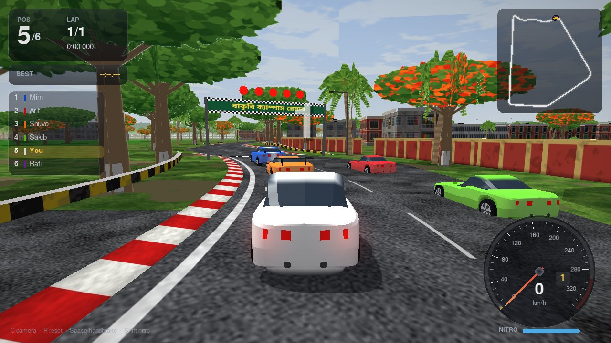
  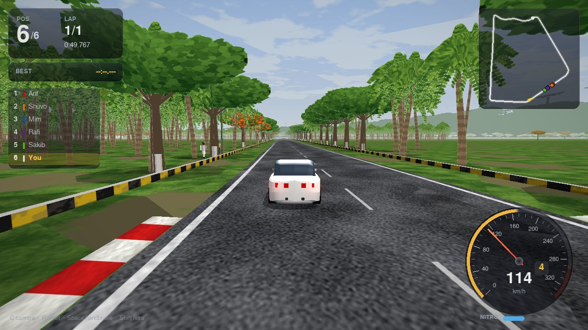
</p>

<p align="center">
  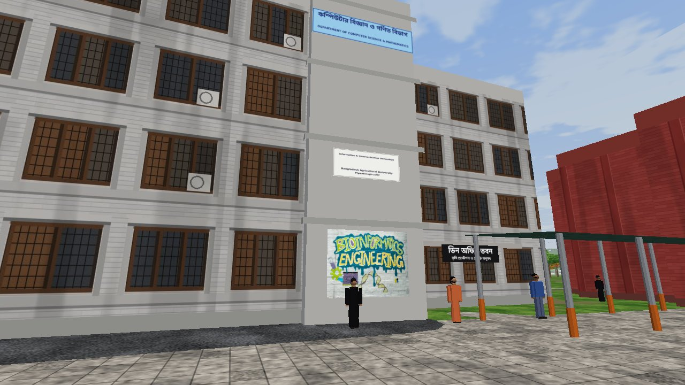
  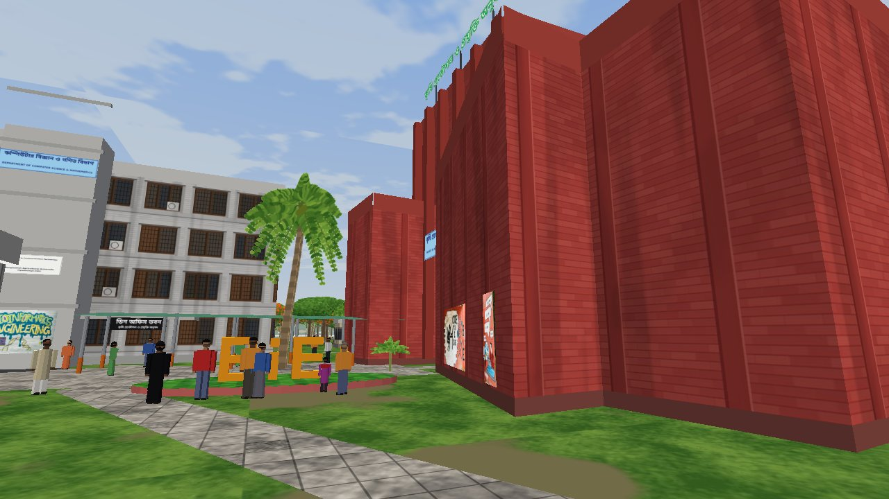
  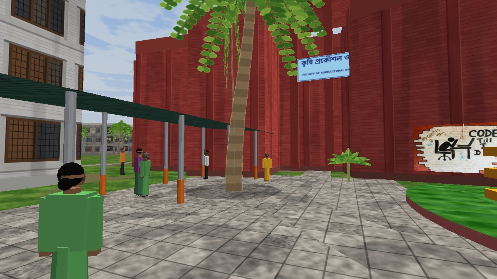
</p>

<p align="center">
  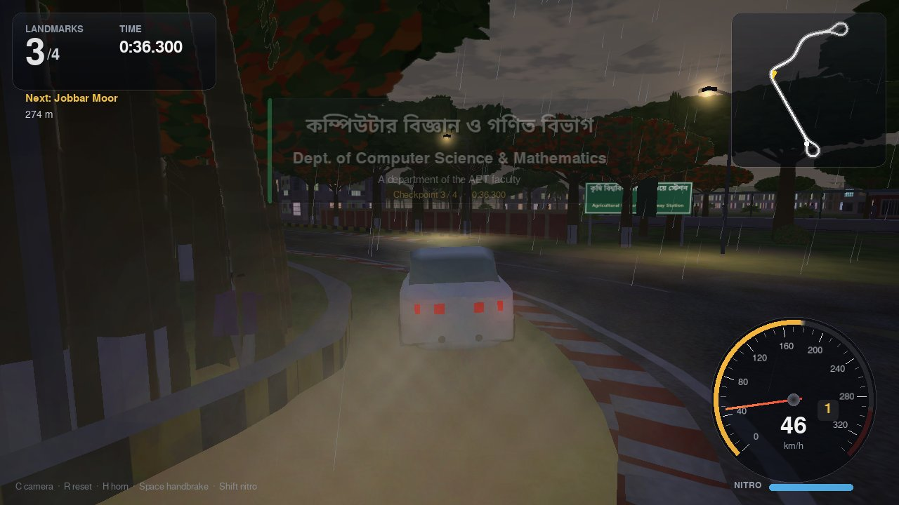
  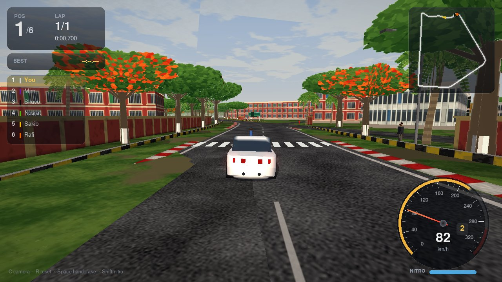
  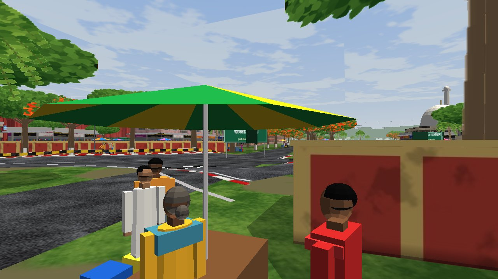
</p>

<p align="center">
  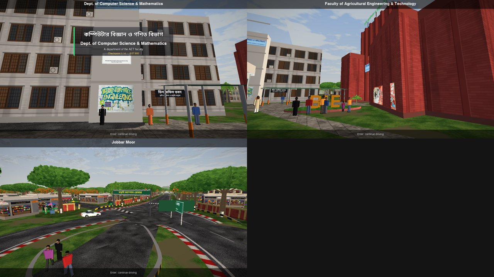
  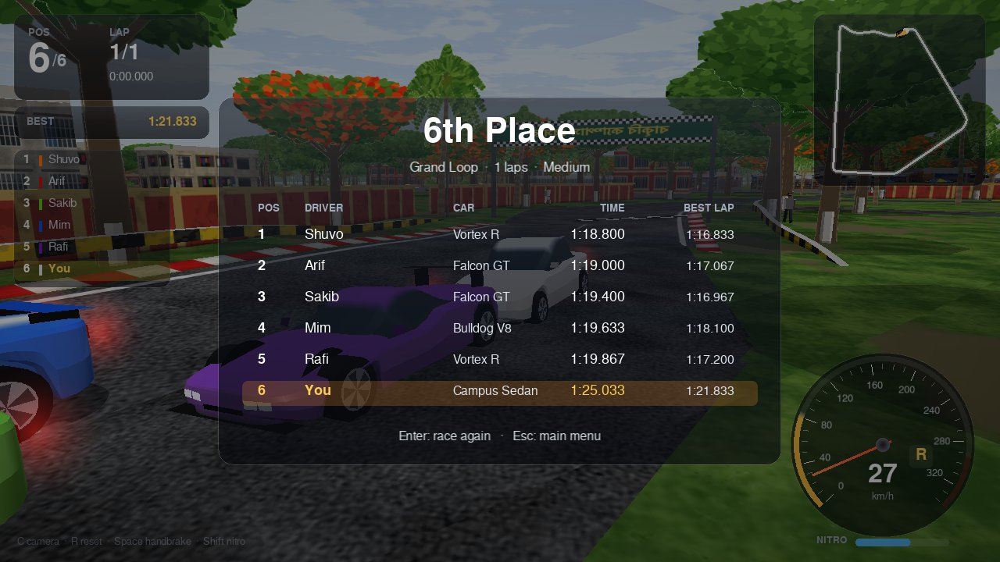
  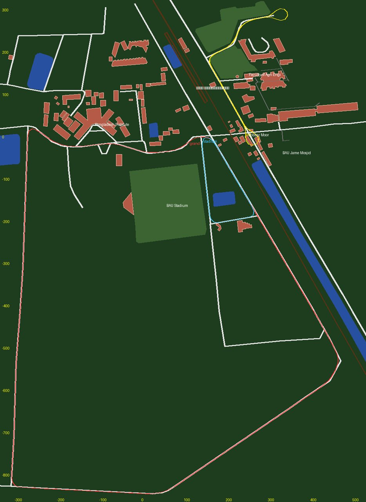
</p>

---

## 🛣️ Routes

**Real map** (OpenStreetMap):

| Route | Length | Passes |
|---|---|---|
| Grand Loop | 2.8 km | BINA, Aambagan Road, coconut grove, railway side |
| Stadium Circuit | 0.5 km | Short, fast loop around BAU Stadium |
| AET - CSM Tour (tour only) | 1.0 km | Jobbar Moor, railway station, CSM Department, AET Faculty |

**Classic map** (approximate layout of the whole campus):

| Route | Length | Passes |
|---|---|---|
| Grand Campus Tour | 2.7 km | KR Market, river ghat, Botanical Garden, Shaheed Minar, Bijoy '71, Central Library, AET, CSM, TSC, halls |
| Academic Circuit | 1.2 km | Auditorium, Central Library, AET Faculty, CSM Department, Faculty of Agriculture, TSC |
| Riverside Run | 1.25 km | Bijoy '71, Shaheed Minar, Botanical Garden, river ghat, Begum Rokeya Hall, KR Market |

---

## 🎮 Controls

| Key | Action |
|---|---|
| W / ↑ | Accelerate |
| S / ↓ | Brake / Reverse |
| A D / ← → | Steer |
| Space | Handbrake |
| Shift / N | Nitro |
| H | Horn |
| C | Change camera (chase / far / hood) |
| R | Reset car to the road |
| P / Esc | Pause |
| Enter | Skip the landmark camera |
| F1 | Show / hide controls help |
| M | Sound on / off |
| F11 | Full screen |

---

## 📂 Project Structure
```
BAU-Campus-Race/
├── main.py            # Window, main loop, keyboard
├── game.py            # Menus, game states, showroom
├── race.py            # Race and tour logic, checkpoints, 3D scene
├── track.py           # Route spline, road, kerbs and barriers
├── car.py             # Car physics, gearbox, wall collision
├── ai.py              # AI drivers
├── crossers.py        # Pedestrians at zebra crossings
├── osmcampus.py       # Real-map campus from OpenStreetMap
├── osm_convert.py     # Converts .osm files into the map JSON and routes
├── campus.py          # Classic campus and shared scenery code
├── env.py             # Sky, time of day, fog, rain, lamps
├── camera.py          # Chase, far and hood cameras
├── effects.py         # Smoke, sparks, skid marks
├── carmodel.py        # 3D cars
├── models.py          # Rickshaw, CNG, bus, people
├── mesh.py            # Geometry builder and display lists
├── gfx.py             # OpenGL helpers, textures, text
├── hud.py             # Speedometer, mini-map, race HUD
├── ui.py              # Menus and result screens
├── sound.py           # Engine sound, effects, music
├── config.py          # Cars, routes, landmarks, settings
├── save.py            # Save file
├── mathutils.py       # Small math helpers
├── README.md
│
├── assets/
│   ├── screenshots/   # Game screenshots
│   ├── labels/        # Bangla text labels
│   ├── campus_osm.json
│   └── *.jpg, *.png   # Textures, signboards, trees
│
├── sounds/            # Engine, effects and music (.ogg)
│
└── osm/
    └── bau_west.osm   # OpenStreetMap export of the campus
```

---

## ⚙ Installation & Setup

### 1️⃣ Install Dependencies
```bash
py -m pip install pygame-ce PyOpenGL numpy
```
On macOS or Linux use `python3 -m pip install pygame-ce PyOpenGL numpy`.

### 2️⃣ Run the Game
```bash
py main.py
```
Keep the `assets`, `sounds` and `osm` folders next to the `.py` files.

### 3️⃣ (Optional) Rebuild the Map
Put new `.osm` files from openstreetmap.org in the `osm` folder, then run:
```bash
py osm_convert.py
```

---

## 🧪 Tested On
- Windows 10 / 11
- Python 3.10+ (tested with Python 3.14)

---

## 🚀 Future Improvements
- Full-campus map including the administrative building, TSC, halls and riverbank
- More landmark buildings modelled from photographs
- Free-roam mode and campus traffic
- Browser version (WebGL)
- Shader-based lighting and real-time shadows

---

## 🗺️ Map Data
Map data © OpenStreetMap contributors, available under the Open Database License (ODbL):
https://www.openstreetmap.org/copyright

---

## 📜 License (MIT)

MIT License

Copyright (c) 2026 [MD. Sakhawat Hossain]

Permission is hereby granted, free of charge, to any person obtaining a copy
of this software and associated documentation files (the "Software"), to deal
in the Software without restriction, including without limitation the rights
to use, copy, modify, merge, publish, distribute, sublicense, and/or sell
copies of the Software, and to permit persons to whom the Software is
furnished to do so, subject to the following conditions:

The above copyright notice and this permission notice shall be included in all
copies or substantial portions of the Software.

THE SOFTWARE IS PROVIDED "AS IS", WITHOUT WARRANTY OF ANY KIND, EXPRESS OR
IMPLIED, INCLUDING BUT NOT LIMITED TO THE WARRANTIES OF MERCHANTABILITY,
FITNESS FOR A PARTICULAR PURPOSE AND NONINFRINGEMENT. IN NO EVENT SHALL THE
AUTHORS OR COPYRIGHT HOLDERS BE LIABLE FOR ANY CLAIM, DAMAGES OR OTHER
LIABILITY, WHETHER IN AN ACTION OF CONTRACT, TORT OR OTHERWISE, ARISING FROM,
OUT OF OR IN CONNECTION WITH THE SOFTWARE OR THE USE OR OTHER DEALINGS IN THE
SOFTWARE.
